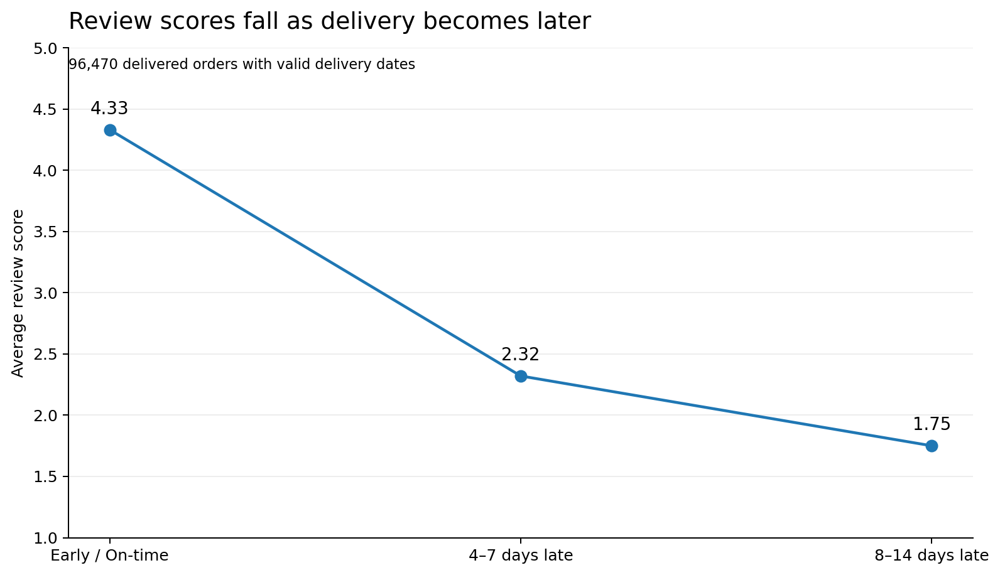
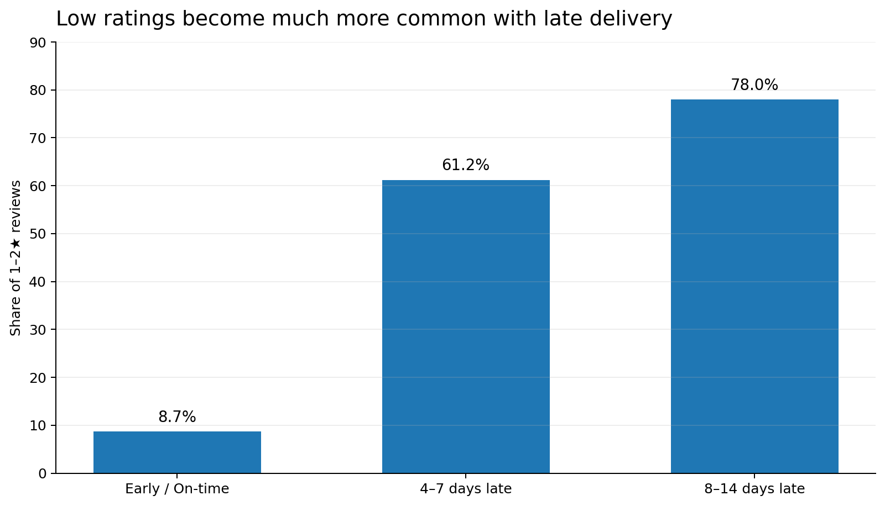
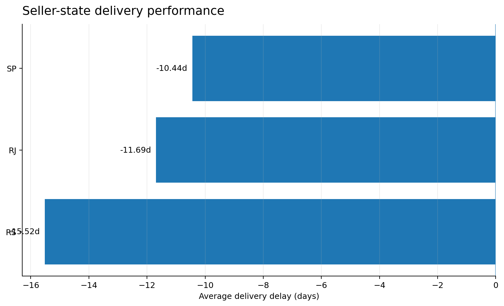

# E-Commerce Delivery & Regional Performance Analysis

I analyzed the Olist Brazilian E-Commerce dataset to answer one question: how
delivery performance relates to customer review scores, and which seller states
should be prioritized for logistics review.

## Business Question

> Does delivery delay relate to lower customer review scores, and which seller
> states should be prioritized for logistics review?

Analysis chain: **delivery delay → customer review score → seller state.**
The results show association, not causation.

## Key Finding

Orders that arrive late get much worse reviews:

| Delivery outcome | Avg review score | 1–2★ review share |
|---|---|---|
| Early / on time | 4.33 | 8.7% |
| 4–7 days late | 2.32 | 61.2% |
| 8–14 days late | 1.75 | 78.0% |



A 4–7 day delay is linked to roughly **2 points lower** average review score.
The full six-band breakdown (including 1–3 day and 15+ day delays) is in the
table under *Analysis results* below and in the notebook.

The pattern also varies by seller state: states with higher average delay show
lower average review scores (r = −0.82 across the six states with ≥1,000
orders; r = −0.75 across all 22 — directional evidence, small n).

## Data

**Source:** [Olist Brazilian E-Commerce Dataset (Kaggle)](https://www.kaggle.com/datasets/olistbr/brazilian-ecommerce).
The raw dataset is not committed to this repository. To reproduce locally:

1. Download the dataset from Kaggle.
2. Place the CSVs in `data/Raw/` (git-ignored).
3. Run `python data/load_mysql.py` to load them into MySQL
   (connection via `MYSQL_HOST` / `MYSQL_PORT` / `MYSQL_USER` /
   `MYSQL_PASSWORD` environment variables; defaults: `127.0.0.1:3307`, user
   `root`, empty password — no credentials are stored in the repo).

Only four of the nine tables are used:

| Table | Rows | Role |
|---|---|---|
| `olist_orders_dataset.csv` | 99,441 | delivery dates, order status |
| `olist_order_items_dataset.csv` | 112,650 | order → seller link (item grain) |
| `olist_sellers_dataset.csv` | 3,095 | seller state |
| `olist_order_reviews_dataset.csv` | 99,224 | review score (1–5) |

No geolocation, product, payment, or customer tables are used.

## Analysis Approach

1. **Delivery delay** = actual delivery date − estimated delivery date
   (positive = late, negative = early). Only `delivered` orders with both dates
   were included: 96,470 of 96,478. Dates in the CSVs are text; I inspected the
   format first (`YYYY-MM-DD HH:MM:SS`), parsed with that exact format, and kept
   every zero, negative, and extreme value after checking the extremes against
   their purchase timestamps.
2. **Order-level grain.** A naive join duplicates orders — items can be up to
   21 per order, and 547 orders carry 2–3 review rows. I pre-aggregated each
   source to one row per order before joining (CTEs in SQL, `groupby` in pandas):
   one seller state per order, mean review score per order. 509 delivered orders
   span more than one seller state and were excluded from the state analysis
   because they have no single home state. The final analytical set is
   **95,322 orders**, and every volume and average below counts orders, not
   item rows.
3. **Seller state** is used for the regional comparison (seller-side, not
   customer-side).
4. **Ranking:** MySQL `RANK()` over average delivery delay (worst = 1).
5. **State comparison threshold:** states need ≥1,000 analyzed orders to be
   compared — chosen after inspecting the volume distribution (SP 67,741 vs
   AM 3). Six states meet it, covering 92,065 of 95,322 orders (96.6%). All 22
   states remain in the output CSV; small states are flagged as small-sample,
   not deleted.
6. **Cross-check:** `sql/delivery_analysis.sql` (MySQL 8) and the pandas
   notebook compute the same metrics independently and match column-by-column
   (max difference = 0). The notebook runs without the database.

One note for reading the results: all state average delays are negative,
because Olist's estimated delivery dates are conservative and most orders
arrive early. The share of orders that actually arrived late is the sharper
delivery-failure measure.

### Analysis results

Full delay-band table (order level):

| Delay band | Orders | Avg review | 1–2★ share |
|---|---|---|---|
| Early ≤ −7d | 70,456 | 4.33 | 8.7% |
| Early/on-time −7d..0d | 17,209 | 4.20 | 10.2% |
| Late 1–3d | 2,634 | 3.77 | 19.0% |
| Late 4–7d | 1,771 | 2.32 | 61.2% |
| Late 8–14d | 1,748 | 1.75 | 78.0% |
| Late 15d+ | 1,504 | 1.71 | 78.7% |

## Priority States

Priority states (full 22-state table in `outputs/state_delivery_analysis.csv`):

| State | Avg delay (d) | Late orders | Avg review | 1–2★ | Volume | Delay rank |
|---|---|---|---|---|---|---|
| **SP** (priority 1) | −10.44 | 8.7% | 4.133 | 13.2% | 67,741 | 2 / 22 |
| **RJ** (priority 2) | −11.69 | 8.3% | 4.253 | 11.4% | 4,106 | 5 / 22 |
| **SC** (priority 3) | −13.31 | 6.0% | 4.209 | 11.8% | 3,495 | 13 / 22 |
| RS (reference, best eligible) | −15.52 | 4.3% | 4.346 | 8.2% | 1,910 | 18 / 22 |

Selection logic, among the six states with ≥1,000 orders: the three worst on
average delay are SP, RJ, MG; the three worst on review score are SP, SC, PR.
SP appears on both lists, so it is priority 1. RJ was taken from the delivery
side and SC from the review side; PR (7,296 orders, 4.213 review) is a close
fourth. Two below-threshold states are worth watching despite smaller samples:
MA (384 orders, 22.7% late, review 4.018) and DF (799 orders, review 4.106).

## Visual Analysis

The share of low (1–2★) reviews jumps from 8.7% for early/on-time orders to
61.2% for orders 4–7 days late:



Comparing the priority states with the best-performing eligible reference
state (RS). Bars are negative because these orders, on average, still arrive
before the (conservative) estimate — the question is how much earlier:



Also in `outputs/`:

- `state_delivery_review_scatter.png` — all 22 states, delay vs review score,
  bubble size = order volume (generated by the notebook).
- `04_delay_review_animation.gif` — optional animated version of the main
  chart; the static PNG above is the primary visual.

## Recommendation

The recommendation is to prioritize **SP** for logistics review first: it is
worst among high-volume states on delivery delay (−10.44 days average, delay
rank 2/22, 8.7% of 67,741 orders late) and has the lowest review score (4.133
vs the 4.346 best-state reference, 13.2% vs 8.2% 1–2★ reviews). Then **RJ**
(delay rank 5, 8.3% late) and **SC** (review 4.209). This is an association
between delivery performance and customer satisfaction, not a demonstrated
causal effect.

## Repository Structure

```text
data/        raw Olist CSVs (local only, git-ignored) + MySQL loading script
notebooks/   executed analysis notebook (pandas, cross-checked against SQL)
sql/         reproducible MySQL analysis, sections 1–9
outputs/     final state-level CSV and charts
```

`OVERNIGHT_REVIEW.md` documents the analytical decisions and validation steps
from the original analysis run.

## Technical Stack

`MySQL • SQL • Python • Pandas • Jupyter Notebook`
